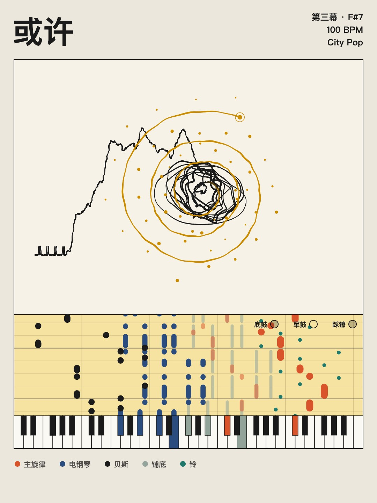
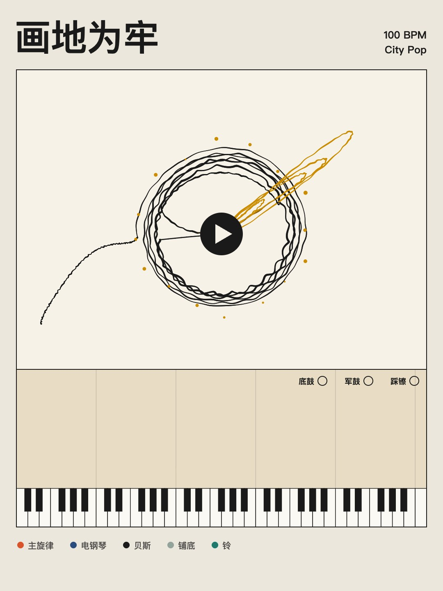
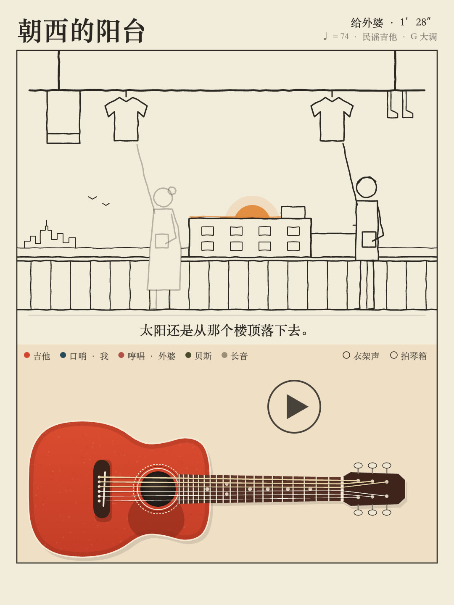

<div align="center">

# 把一段话变成一首歌

**我不会编曲，也不懂代码。但我写的一段话，现在是一首歌了。**

<table>
<tr>
<td></td>
<td></td>
<td></td>
</tr>
<tr>
<td align="center">《或许》· city pop</td>
<td align="center">《画地为牢》· city pop</td>
<td align="center">《朝西的阳台》· 民谣吉他</td>
</tr>
</table>

</div>

---

## 这是什么

人们写下一段文字随笔时，写的往往是此刻的心情。

这个 Skill 可以把这段话编成一首曲子，文字留给你的想象空间和音乐在此刻共振，播放的时候，一根线随着心情起伏，在纸上慢慢画开；音符跟着节拍一颗颗落下。

它是给 AI 编程助手（Claude Code、Codex 这类）用的。装上之后，给它一段话、一张图，或者只是一句「不想说话」就行，最后得到一个一分多钟的竖版音乐视频。

起因是我在小红书刷到有人用 Fable 5.2 写代码做了一首 city pop，我也想编一首。我是文科生，做产品的，五线谱看不懂，代码也不会写。我能做的只有一件事：把我的感受说出来，然后听、看、说「不对」。

这个 Skill 里写的，就是我说了几十次「不对」之后留下来的东西。

## 和 Suno 的区别

Suno 是直接生成一段音频。这个是**写谱子**：每一个音都是 AI 用代码写出来的，哪一拍、哪个乐器、弹哪个音，再由浏览器当乐队演奏出来。

所以它有两个特点：

- **每个音都能改。** 你可以说「后面有点单调」「贝斯别这么抢」，它是真的去改那几个音。
- **做不了人声和真乐器的质感。** 出来是合成器味的纯音乐，适合 city pop、lo-fi、合成器浪潮这类本来就靠合成器的风格。

## 这个 Skill 帮你做什么

直接让 AI「做首歌」，通常会得到一段哪段文字都能配的背景音乐。装上这个 Skill 之后：

1. **它会先读你的心情，再说回给你听。** 你不用讲清楚「从什么到什么」，一句话就够。它读完会用两三句话告诉你它的理解，你只需要说「对」或者「不是」。
2. **它会把你的文字拆成几幕，每一幕配一个听得懂的手法。** 比如「卡住、没有进展」不是把一句旋律重复四遍（那只会无聊），而是旋律原地不动、落点一次比一次低。
3. **它会从你的文字里挑一个细节变成声音。** 文字里写到下雨，雨声就在那一句进来；写到按了一下车铃，全曲就只在最后响那一声。这是让这首歌只属于这段话的地方。
4. **它不会替你乐观。** 如果你的文字停在「也还行」，音乐就不能替你宣布已经很好了。我的第一首歌，曲名就叫《或许》。
5. **它会问你文字能不能出现在画面上。** 我有一首不想让人看到原文，画面上就一个字都没有，只有一根线。
6. **它会对你说实话。** AI 听不到声音。它会把「我查过的」和「只能你来听的」分开告诉你，不会用一句「已完成」糊弄过去。

## 安装

把这个仓库的链接发给你的 AI，让它安装。或者手动：

```bash
git clone https://github.com/luolan0214/text-to-music-skill ~/.claude/skills/text-to-music
```

然后直接说，比如：

```
帮我把这段话编成一首歌：
周五晚上十一点的地铁，车厢里只有我和一个睡着的外卖员。
……
站在屋檐下吃完，忽然觉得今天也还行。
```

没法装 Skill 的话，用 [`references/prompt.md`](references/prompt.md)：把里面那一大段话发给任何一个 AI，再贴上你的文字。在普通聊天窗口里也能得到一个可以播放的网页，只是出不了视频。

## 需要准备

| 东西 | 用途 | 没有的话 |
|---|---|---|
| Chrome 浏览器 | 播放、看画面 | 必需 |
| Node.js 和 playwright | 自检、出视频 | 只能在网页里听和看，用页面上的按钮录屏 |
| ffmpeg | 合成 mp4 | 同上 |

不需要任何付费的音乐或生图工具。声音全部是浏览器现算的。

## 流程

```
对齐 → 分幕 → 写歌 → 自检 → 你来听 → 出视频
```

1. **对齐**：素材、心情、风格、文字能不能公开
2. **分幕**：把文字拆成几幕，给你看一张表，你点头再写
3. **写歌**：从模板改，只换音乐和那根线怎么走
4. **自检**：有没有报错、会不会爆音、每一幕是不是真的一段比一段不一样
5. **你来听**：好不好听只有你知道
6. **出视频**：逐帧渲染，1080×1440

## 目录

| 路径 | 内容 |
|---|---|
| [`SKILL.md`](SKILL.md) | 整体流程和每个阶段怎么验收 |
| [`assets/template/`](assets/template) | 模板：一首完整的《或许》，新歌从复制它开始 |
| [`scripts/render.cjs`](scripts/render.cjs) | 自检和出视频 |
| [`references/structure.md`](references/structure.md) | 怎么把文字拆成幕；情绪和手法的对照表 |
| [`references/visuals.md`](references/visuals.md) | 画面：那根线怎么画、乐器、图例、封面、隐私 |
| [`references/engine.md`](references/engine.md) | 模板怎么改、底座里有哪些现成的乐器和选项 |
| [`references/style-citypop.md`](references/style-citypop.md) | city pop 配方 |
| [`references/style-synthwave.md`](references/style-synthwave.md) | 合成器浪潮配方 |
| [`references/style-folk-guitar.md`](references/style-folk-guitar.md) | 民谣吉他配方，含模拟拨弦的代码 |
| [`references/pitfalls.md`](references/pitfalls.md) | 踩坑清单，按「我会说的那句话」来查 |
| [`references/prompt.md`](references/prompt.md) | 不装 Skill 也能用的一段话版本 |

## 许可

- **Skill 本身**（本仓库的文档、模板和脚本）：[AGPL-3.0](LICENSE)
- **演示里的歌**（《或许》《画地为牢》《朝西的阳台》的音乐和画面）：© 2026 luolan在学AI，保留所有权利。欢迎看和分享链接，未经许可请勿转载、改名再发布或商用

## 作者

luolan在学AI（小红书同名）。一个在学 AI 的产品经理。如果你用它做出了自己的歌，欢迎发给我听。
